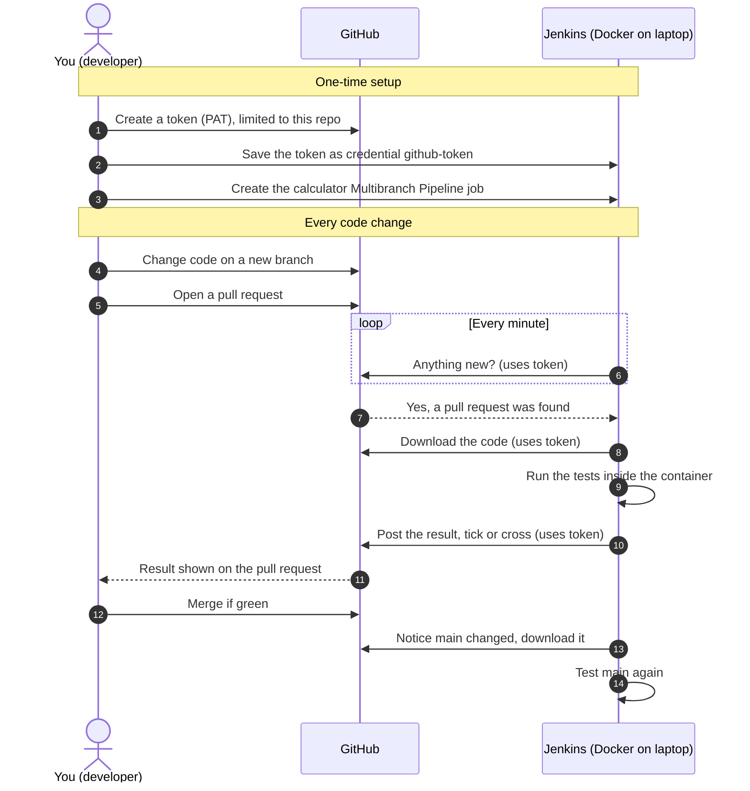
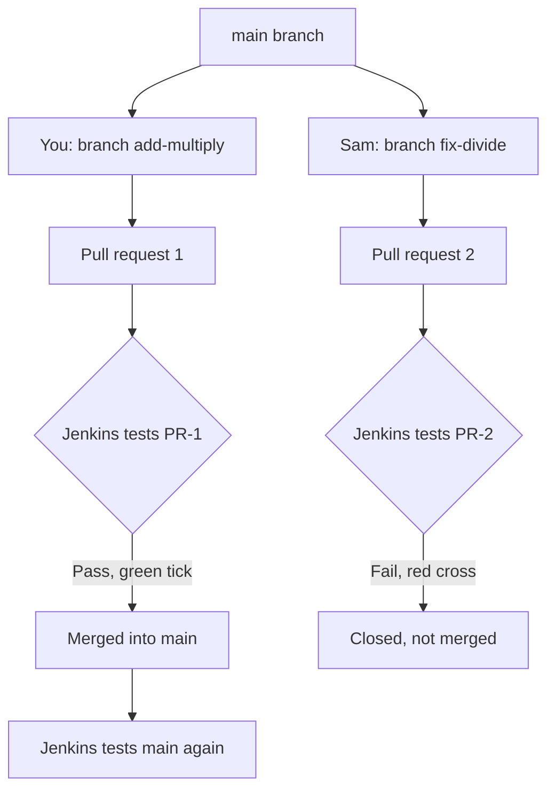

# Jenkins lab: how GitHub and Jenkins work together

A small learning project. A Python calculator app is tested automatically by Jenkins every time code changes on GitHub.

## What's in this repo

| File | Purpose |
|---|---|
| `app/calculator.py` | The app being tested |
| `tests/test_calculator.py` | The tests Jenkins runs |
| `Jenkinsfile` | The pipeline: instructions Jenkins follows on every build |
| `Dockerfile` | Builds the Jenkins image, with Python and pytest included |
| `docker-compose.yml` | Starts Jenkins locally on http://localhost:8080 |
| `pytest.ini` | Tells pytest where the tests and code are |

## The three players

- **You (the developer):** write code and open pull requests.
- **GitHub:** a website that stores the code, branches and pull requests.
- **Jenkins:** an automation server, running in Docker on your laptop. It downloads the code, runs the tests and reports the result.

## The complete workflow

The numbers show the order things happen in.



## Two developers working at the same time

Each developer works on their own branch. Jenkins tests each pull request separately, so a mistake on one branch never reaches `main`.



## How GitHub and Jenkins are connected

**Jenkins always contacts GitHub, never the other way round.** Jenkins runs on a laptop, so GitHub can't reach it. That's why Jenkins checks GitHub every minute. In a real company setup, Jenkins runs on a shared server and GitHub notifies it instantly using a **webhook**.

**The token (PAT) is a limited key Jenkins uses to act on GitHub.** It's a fine-grained personal access token, and each permission maps to a step in the workflow:

| Token permission | Used for |
|---|---|
| Contents: Read-only | Downloading the code |
| Pull requests: Read-only | Finding new pull requests |
| Commit statuses: Read and write | Posting the tick or cross on the pull request |
| Metadata: Read-only | Added automatically by GitHub |

The token is limited to this one repo, can't change code, and expires after 30 days. It's stored in Jenkins as a credential (`github-token`), so it never appears in the `Jenkinsfile` and is masked as `******` in build logs.

## Why Jenkins tests `main` again after a merge

A pull request is tested on its own, as the branch was written. Meanwhile, other changes may have been merged into `main`. Two changes can each pass alone but break when combined. Rebuilding `main` after every merge catches that straight away. It also catches changes committed directly to `main` without a pull request.

## Key terms

| Term | Meaning |
|---|---|
| Pipeline | The set of steps Jenkins runs, defined in the `Jenkinsfile` |
| Stage | A named section of the pipeline, such as Test or Package |
| Step | A single command inside a stage |
| Workspace | The folder where Jenkins downloads the code and runs the steps |
| Exit code | A number every command returns. 0 means success; anything else fails the build |
| Artifact | A file a build produces and keeps, such as the packaged app |
| Multibranch Pipeline | A Jenkins job that automatically builds every branch and pull request |

## Lessons learned while building this

- **Exit code 137** means the process was forcibly killed (SIGKILL). It's usually memory, but not always. Here, `pip install` was being killed even with plenty of memory free, and the root cause wasn't found. The fix was to install pytest into the Docker image at build time instead of during each pipeline run, which is also faster and good practice.
- **Exit code 2 from pytest** means the tests couldn't run at all, for example when files are in the wrong folders. **Exit code 1** means the tests ran but some failed.
- **403 "Resource not accessible by personal access token"** means the token is missing a permission. Here it was Commit statuses: Read and write.
- **Committing straight to `main`** skips pull request checks. A GitHub ruleset on `main` can block this and require a green build before merging.

## Security notes

- Jenkins holds secrets and runs code, which makes it a valuable target for attackers.
- Anyone who can edit the `Jenkinsfile` can make Jenkins run any command, so pull requests from untrusted people should never be built automatically with access to credentials.
- Jenkins is bound to `127.0.0.1` in `docker-compose.yml`, so it's only reachable from this laptop.

## Running it

```bash
docker compose up -d --build
docker compose exec jenkins cat /var/jenkins_home/secrets/initialAdminPassword
```

Then open http://localhost:8080.

## Cleaning up

When finished with the lab, delete the GitHub token (**Settings > Developer settings > Personal access tokens**) and the `github-token` credential in Jenkins.
